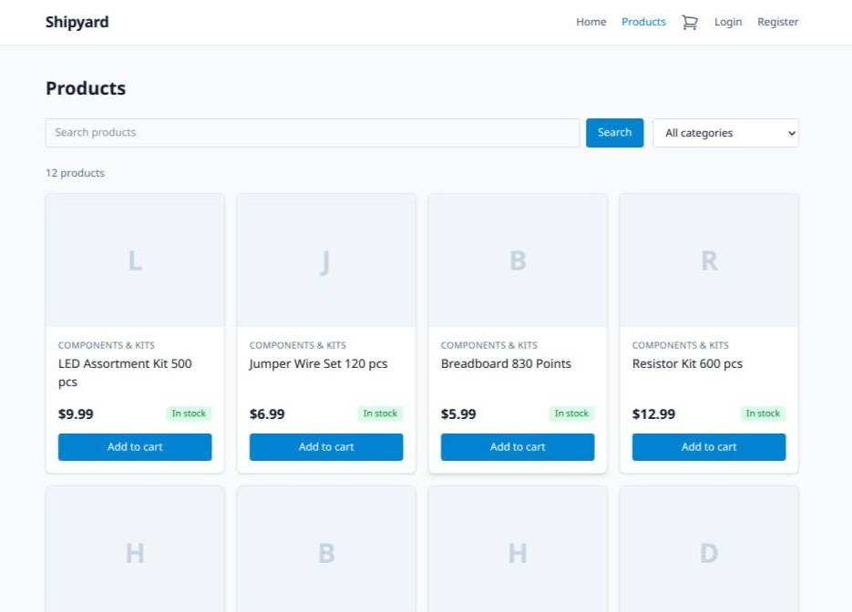
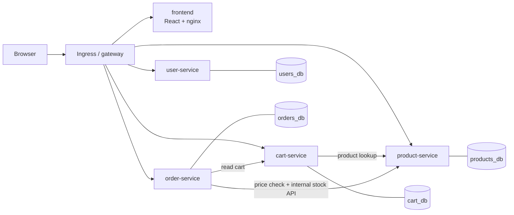
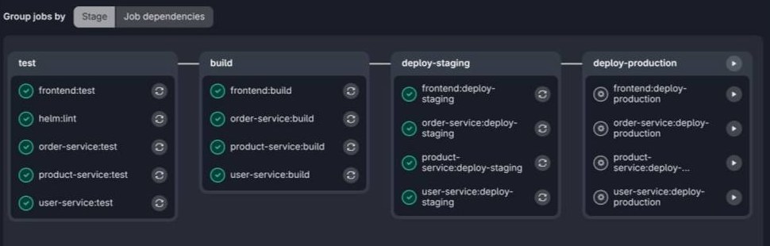
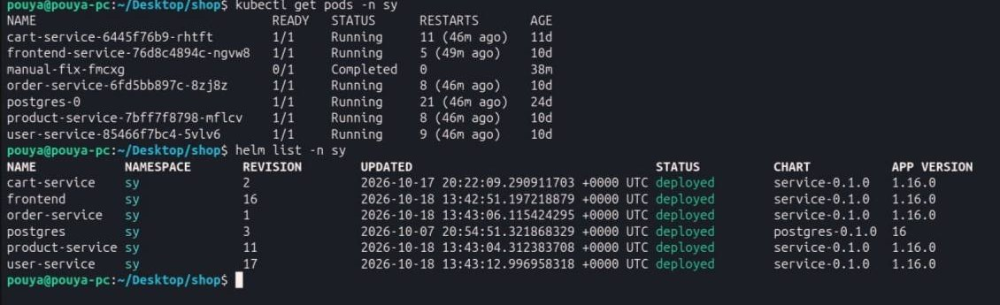

# Shipyard

[](https://github.com/pouyaz05/shipyard/actions/workflows/ci.yml)

An online shop for electronic parts (ESP32 boards, sensors, modules), built as a small microservice system to practice the whole delivery path: **containers → CI → Helm → Kubernetes**.

> Portfolio project. The shop features are deliberately small; the focus is on how the system is built, tested, packaged and deployed.

## Highlights

- Four FastAPI services and a React frontend, with **one database per service**
- **One generic Helm chart** reused by every service; each service is only a values file
- GitLab CI/CD: automatic staging deploy, manual production gate, **automatic rollback** when a release does not become ready
- Database migrations as Helm hook Jobs, and a nightly Postgres backup whose restore was tested
- One-command local stack with Docker Compose and a scripted end-to-end purchase test

## Features

Browse and search products, register and log in (JWT), cart, checkout with stock reservation, order history and a simulated payment.



## Architecture



One PostgreSQL instance, **one database per service**. Services talk to each other over HTTP only, never through another service's database.

| Service | Stack | Responsibility |
|---|---|---|
| `frontend` | React 18, Vite, TypeScript, Tailwind, vitest; served by unprivileged nginx | UI |
| `user-service` | FastAPI, SQLAlchemy 2, Alembic | Registration, login, issues JWTs |
| `product-service` | FastAPI, SQLAlchemy 2, Alembic | Catalog and stock; internal stock endpoints |
| `cart-service` | FastAPI, SQLAlchemy 2, Alembic | Per-user cart, verifies JWTs, stores price/name snapshots |
| `order-service` | FastAPI, SQLAlchemy 2, Alembic | Checkout, orders, simulated payment |

## Quick start (Docker Compose)

Requirements: Docker with Compose v2, `make`, `openssl`.

```bash
git clone https://github.com/pouyaz05/shipyard.git && cd shipyard
make up      # builds the images, creates .env with random dev secrets, runs migrations, starts everything
make seed    # loads demo products
```

Open <http://localhost:8080>. Then:

```bash
make e2e     # scripted purchase: register, login, cart, checkout, pay, stock checks
make test    # backend tests (python:3.12 container)
make logs    # follow logs
make down    # stop (keeps data)   |   make clean  # stop and delete data
```

The Compose file mirrors the cluster layout: a small nginx gateway plays the Ingress, and each service has a one-shot `*-migrate` container (`alembic upgrade head`) that must finish before the app starts.

### Troubleshooting

- **`pip` or `npm` times out during `make up`:** set a mirror in `.env`, for example `PIP_INDEX_URL=<mirror>/simple`, `PIP_DEFAULT_TIMEOUT=120` and `NPM_CONFIG_REGISTRY=<mirror>`, then run `make up` again (finished layers are cached).
- **Port 8080 is busy:** set `GATEWAY_PORT` in `.env`.
- **`make seed` says a service is not running:** check `make ps` and `make logs`.
- **Start from scratch:** `make clean && make up`.

## CI/CD

**GitLab CI is the primary pipeline** (self-hosted runner, see `.gitlab-ci.yml`):

```
test → build (+ push) → deploy-staging (automatic) → deploy-production (manual)
```


*Tests, image builds and the staging deploy run automatically; the production jobs wait for a manual approval.*

- Pipelines run only for merge requests and for `main`.
- Each service has its own jobs, triggered by `rules: changes` on its code, the shared chart and its values file.
- Images are tagged with the **commit SHA** (never `latest`) and built once; the same image is promoted from staging to production.
- Deployment is push-based: `helm upgrade --install --rollback-on-failure`, so a release that never becomes ready is rolled back automatically.
- Database migrations run as a Helm `pre-install,pre-upgrade` hook Job, never at application startup.

**GitHub Actions** (`.github/workflows/ci.yml`) re-runs the checks that do not need my cluster: unit tests, frontend tests and build, `helm lint`, image builds, the Compose end-to-end test, plus gitleaks and Trivy (report-only for now).

## Kubernetes

- `k8s/charts/service`: one generic chart for every stateless app (Deployment, Service, Ingress, optional HPA, ServiceAccount, migration Job). Each service is just a values file in `k8s/values/`.
- `k8s/infra/postgres`: PostgreSQL as a StatefulSet with a persistent volume.
- `k8s/infra/postgres-backup`: nightly `pg_dumpall` CronJob; restores were tested. The job waits for Postgres to be reachable and may start up to six hours late, because a laptop cluster is not always on.
- Secrets are created out of band with `kubectl` and are never committed. Each values file lists the Secret it consumes under `secretRefs`; the required keys are the variables in `docker-compose.yml`.

```bash
helm upgrade --install cart-service k8s/charts/service -n sy \
  -f k8s/values/cart-service.yaml \
  --set image.repository=<registry>/cart-service --set image.tag=<git-sha> \
  --rollback-on-failure
```


*Six workloads on a single-node kind cluster, deployed with Helm. The restart counters come from suspending and rebooting the laptop.*

Tested on a single-node kind cluster. The production jobs exist in the pipeline but are manual, and no separate production namespace is provisioned in my setup; staging is the `sy` namespace.

## Design decisions

- **Build once, deploy many.** The image tested on staging is the image that goes to production; only configuration differs.
- **Immutable tags.** SHA tags give traceability and real rollbacks; `latest` does neither.
- **Migrations are a separate step.** Several replicas starting at once must not race on the schema.
- **Database per service.** No cross-service table access; services only use each other's APIs.
- **Checkout without distributed transactions.** The order service reads the cart, re-checks prices with the product service, reserves stock with an atomic `UPDATE ... WHERE stock >= n`, and undoes earlier reservations if a later step fails. The order stores an immutable snapshot of name, price and quantity.
- **Internal endpoints stay internal.** `/internal/*` requires an internal key and is routed by neither the Ingress nor the Compose gateway.
- **Money is integer cents.**
- **Fail-fast configuration.** A service refuses to start on invalid config and prints only variable names, never values.
- **Hardening basics.** Multi-stage slim images, non-root user (UID 10001), pinned dependencies, no secrets in Git.

## Roadmap

- Pull-based CD with Argo CD (today it is push-based)
- Prometheus and Grafana, `/metrics` in the services
- NetworkPolicies, per-service database roles, read-only root filesystem
- Role-based admin access instead of the temporary admin API key
- Product reviews

## Repository layout

```
services/<name>/   FastAPI services (app/, alembic/, tests/, Dockerfile)
frontend/          React app and nginx config
k8s/               generic chart, per-service values, infrastructure charts
docker/            gateway and database init for Docker Compose
scripts/           end-to-end test
docs/              project conventions and screenshots
```

## License

MIT
